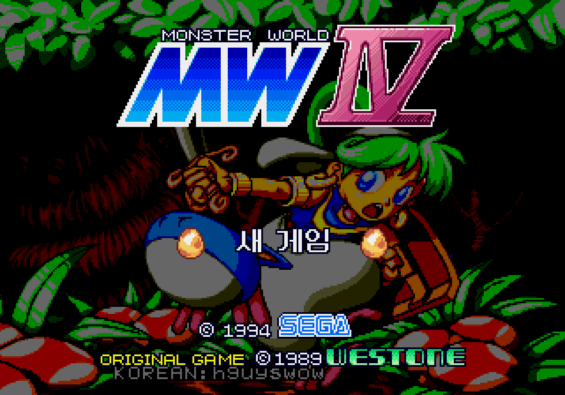
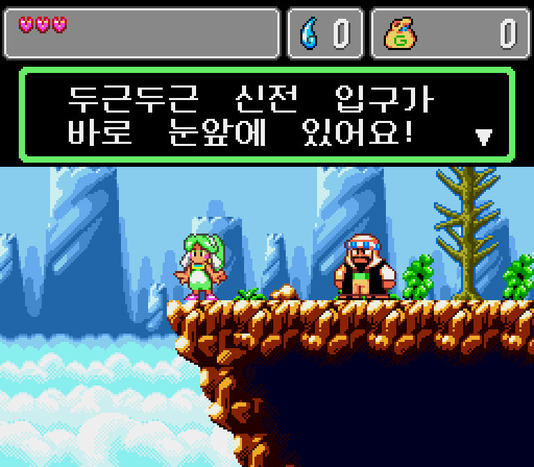
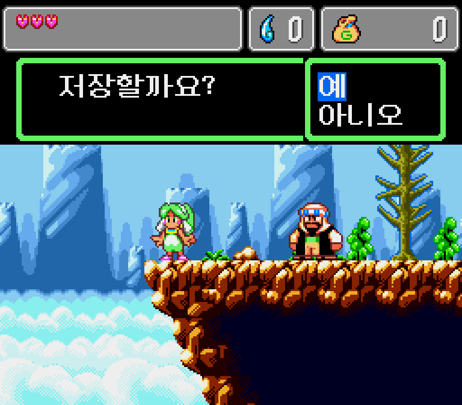
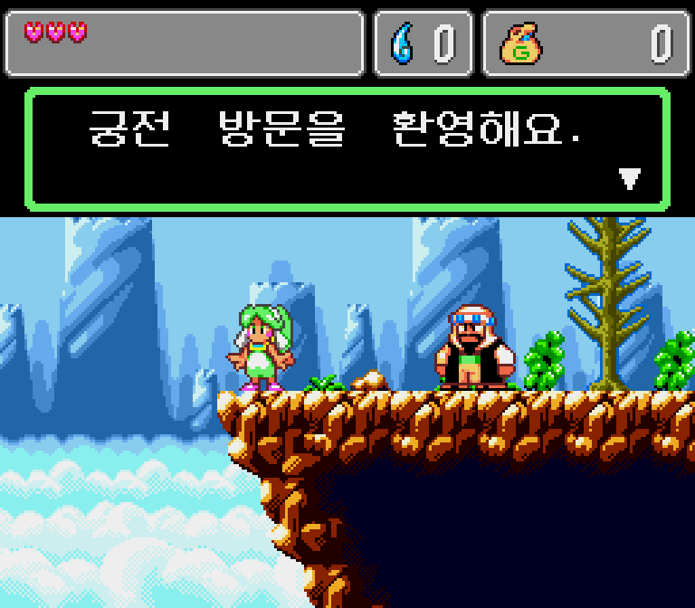
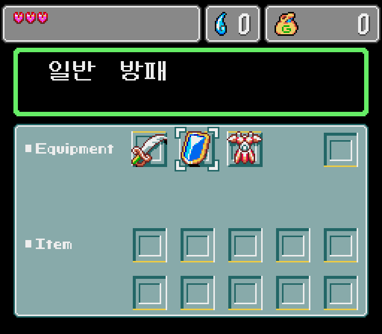
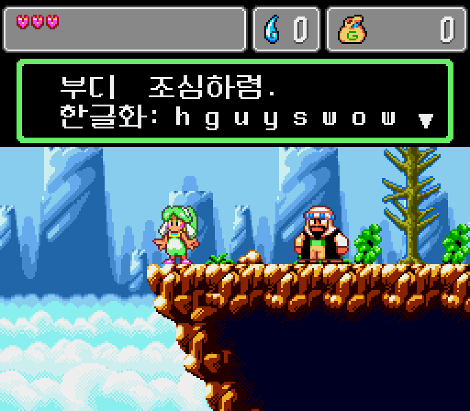

# 몬스터 월드 IV (Monster World IV) 메가드라이브 한글화 패치

> ## 🔰 처음이신가요? 3분 적용 가이드 (Quick Start)
>
> **준비물**: ① 일본어판 `Monster World IV (Japan)` 롬 파일 (본인이 가진 카트리지에서 받은 파일) ② 이 저장소의 패치 파일 `monster4_ko.ips`
> (※ 롬은 이 저장소에 들어 있지 않습니다. 영문판/미국판(Virtual Console) 롬에는 적용되지 않습니다.)
>
> ### 방법 A — 웹에서 바로 적용 (설치 필요 없음, 제일 쉬움)
> 1. 오른쪽 **Releases** 에서 `Monster_World_IV_KO_patch_v1.0.zip` 을 받아 압축을 풉니다.
> 2. 브라우저에서 **Rom Patcher JS** 를 엽니다: https://www.marcrobledo.com/RomPatcher.js/
> 3. **ROM file** 칸에 일본어판 롬 파일을 넣고, **Patch file** 칸에 `monster4_ko.ips` 를 넣습니다.
> 4. **Apply patch** 를 누르면 한글화된 롬 파일이 다운로드됩니다. (파일명을 `mw4ko.md` 처럼 짧은 영문으로 바꾸면 편합니다.)
>
> ### 방법 B — 파이썬이 있다면 (안전 검사 포함)
> 압축 푼 폴더에서 `python apply_patch.py "일본어판롬경로"` 를 실행하면 원본 롬 확인 → 패치 → 결과 확인까지 자동으로 해줍니다.
>
> ### 잘 됐는지 확인
> 결과 롬 파일 크기가 **2,097,152 바이트**이고, 해시(SHA256)가 `7095A4A82AC132DEDE3A42CD6A77D9E568AC1C801F84A8B239AB96093345E398` 이면 정상입니다. (원본 일본어판 해시: `3796F407AE0BF3B74BBE53335ADF57F295F0BF53EF7D82B603AC73350EAC8CAE`)
>
> ### 플레이 방법
> - **PC 에뮬레이터**: BizHawk, Genesis Plus GX(RetroArch), Kega Fusion 등에서 결과 롬을 열면 됩니다.
> - **플래시카트(MD v3 Pro 등)**: 결과 롬을 SD카드에 복사해서 실행합니다. 파일명은 짧은 영문/숫자로, 확장자는 `.md` 또는 `.bin` 이 안전합니다.
>
> ### 안 될 때
> - 패처가 "체크섬 불일치" 경고를 내면 → 롬이 일본어판이 아니거나 형태가 다른 덤프입니다. 위 원본 해시와 비교해 보세요.
> - 화면이 깨지거나 시작이 안 되면 → 영문판(미국/유럽) 롬에 적용했는지 확인하세요.
> - 그래도 안 되면 **Issues** 에 롬 파일 크기와 해시값(롬 자체는 올리지 마세요), 증상을 적어 주세요.
>
> ---
> **English quick start**: Get your own dump of *Monster World IV (Japan)* (2,097,152 bytes, SHA256 `3796F407…EAC8CAE`). Download the ZIP from Releases, then apply `monster4_ko.ips` with any IPS patcher (e.g. https://www.marcrobledo.com/RomPatcher.js/ or `python apply_patch.py "rom"`). Expected result SHA256: `7095A4A8…45E398`. The patch will NOT work on the USA/EU Virtual Console ROM. No ROM is included here.


1994년 세가(SEGA)/웨스톤(Westone)의 메가드라이브 액션 RPG **『몬스터 월드 IV (Monster World IV)』** 일본어판 롬을 한국어로 바꾸는 비공식 IPS 패치입니다. 롬은 포함되어 있지 않습니다.


## 스크린샷 / Screenshots

| | |
|---|---|
|  타이틀 |  도입부 대사 |
|  저장 / 예·아니오 메뉴 |  궁전 대사 |
|  장비 메뉴 |  제작자 표시 |

*Screenshots are from an emulator (BizHawk). Game graphics (c) SEGA / Westone. This repository contains no ROM.*


## 1. 필요한 원본 롬

- 일본어판 `Monster World IV (Japan)`, 카트리지 번호 **GM G-5519**
- 파일 크기 정확히 `2,097,152` 바이트, 헤더 체크섬 `0x77AE`
- **SHA256**: `3796F407AE0BF3B74BBE53335ADF57F295F0BF53EF7D82B603AC73350EAC8CAE`

미국/유럽 버추얼 콘솔판, 영문 패치본, 크기나 해시가 다른 덤프에는 적용되지 않으며 자동으로 거부됩니다.

## 2. 패키지 구성

- `monster4_ko.ips`: IPS 패치 (69,067 바이트)
- `apply_patch.py`: 원본 롬 검증 + 패치 적용 + 결과 검증 (파이썬 3.8 이상, 표준 라이브러리만 사용)
- `CHECKSUMS.txt`: SHA256 목록
- `FONT_LICENSE_NeoDunggeunmo_OFL.txt`: 한글 글리프 폰트의 라이선스 전문 (SIL OFL 1.1)
- `README_ko.md`: 이 문서

## 3. 적용 방법

```bash
python apply_patch.py "경로/Monster World IV (Japan).md"
python apply_patch.py "경로/Monster World IV (Japan).md" -o "경로/mw4ko.md"   # 출력 경로 지정
python apply_patch.py "경로/Monster World IV (Japan).md" -f                   # 기존 파일 덮어쓰기
```

적용이 끝나면 결과 롬을 자동 검증합니다.
- 크기 `2,097,152` 바이트, 헤더 체크섬 `0x5D76`
- **SHA256**: `7095A4A82AC132DEDE3A42CD6A77D9E568AC1C801F84A8B239AB96093345E398`

온라인 IPS 패처나 Lunar IPS 로 `monster4_ko.ips` 를 직접 적용해도 같은 롬이 만들어집니다.

## 4. 번역 내용

- 제작자: `KOREAN:hguyswow` (타이틀 화면 중앙 하단 저작권 표기 바로 아래 및 도입부 아버지 대사에 표시)
- 대사 268개 한글화 (해요체 중심, 아샤/페페로그 이름 치환 연동) — 269번째(`dialog_268`)는 미번역
- 장비/아이템 130개 이름·설명, 지명 8개, 시스템 메시지 31개, 이름·사운드 테스트 문구 한글화
- 타이틀 메뉴 `NEW GAME` → `새 게임` (`이어하기` 스프라이트도 같은 방식으로 교체)
- 68000 게임 코드는 한 바이트도 바꾸지 않았고, 대사/폰트/문자열 데이터와 포인터, 헤더 체크섬만 변경됩니다.

## 5. 폰트 고지 (Neo둥근모, SIL OFL 1.1)

한글 16x16 글리프는 **Neo둥근모(Neo Dunggeunmo)** 에서 래스터화했습니다.
Based on glyphs by Eunbin Jeong (Dalgona.), SIL Open Font License 1.1.
Copyright (c) 2017-2021, Eunbin Jeong (Dalgona.). 라이선스 전문은 `FONT_LICENSE_NeoDunggeunmo_OFL.txt` 를 보세요.
이 패치에서 폰트 파생 비트맵 부분은 OFL 1.1 조건을 따르며, 이 패치는 폰트 이름을 내세우지 않는 별개의 수정물입니다.

## 6. 알려진 한계

1. `dialog_268` 한 건은 번역되지 않았습니다.
2. 상점/주민의 2회차 이상 분기 대사와 타이틀 `이어하기`(세이브가 있을 때 나타남)는 실엔진에서 확인하지 못했습니다.
3. 그림으로 된 글자(타이틀 로고, 저작권 표기, `PRESS START`, 메뉴의 `Equipment`/`Item`)는 원작 그대로 영문입니다.
4. 예/아니오 선택창의 하이라이트 폭이 글자 폭과 맞지 않을 수 있습니다.
5. 확인한 환경은 에뮬레이터(BizHawk 2.11.1, Genesis Plus GX 코어)뿐이며 실기와 플래시카트는 미검증입니다.

## 7. 플래시카트 사용 팁 (MD v3 Pro 등, 미검증 일반 팁)

- 롬 파일명은 짧고 단순하게(영문/숫자) 바꾸고 확장자는 `.md` 또는 `.bin` 으로 출력하세요 (`-o mw4ko.md`).
- 이 게임은 SRAM 세이브를 씁니다. 카트에서 세이브가 실제로 저장/불러오기 되는지 먼저 확인하세요.

## 8. 저작권 및 면책

- 롬 파일은 포함하지 않습니다. 본인이 합법적으로 가진 카트리지에서 덤프한 롬에만 사용하세요.
- 몬스터 월드 IV의 저작권은 SEGA 및 Westone 에 있습니다.
- 이 패치로 생기는 어떤 손해에도 제작자는 책임지지 않습니다.
